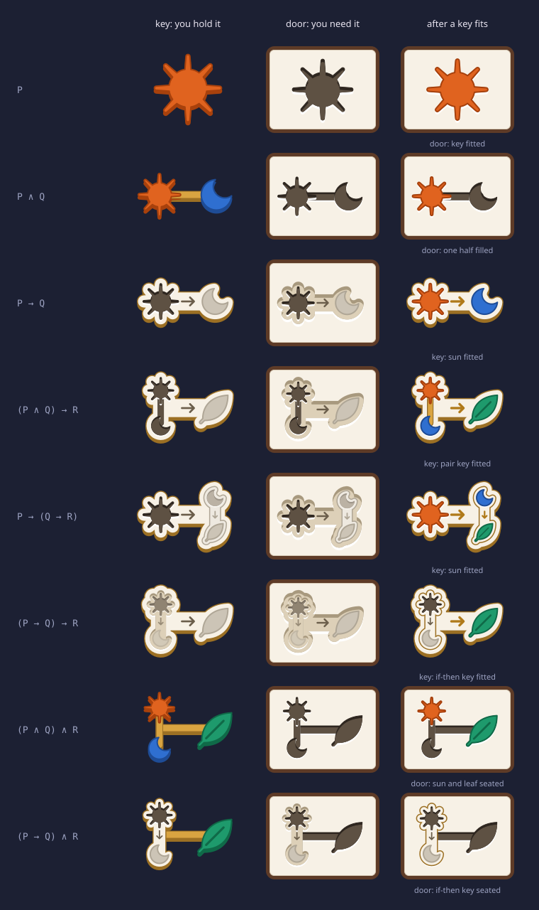
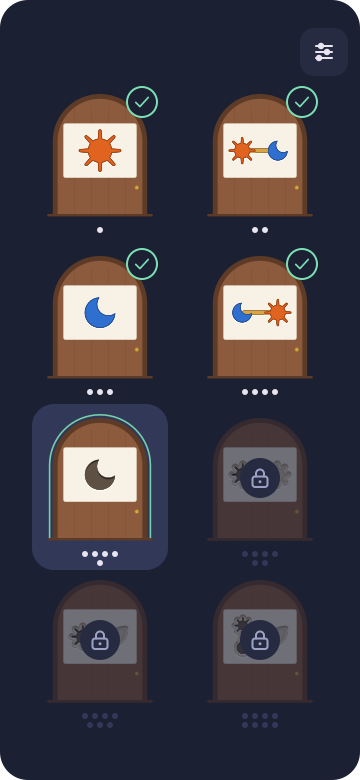
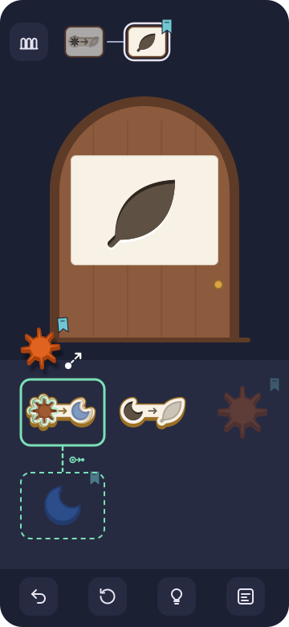
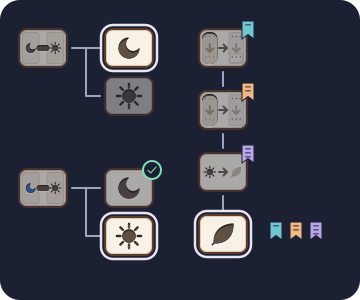
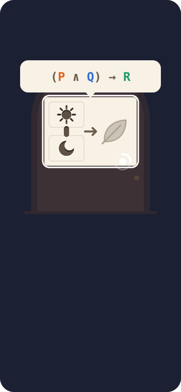
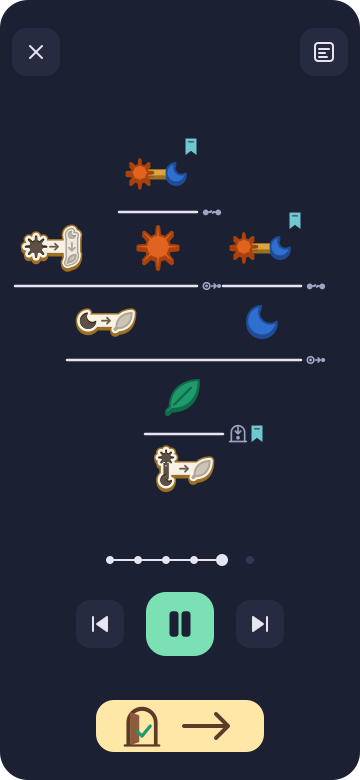
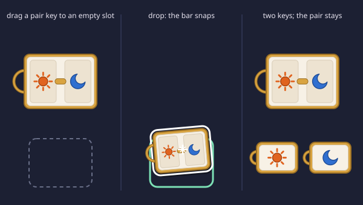
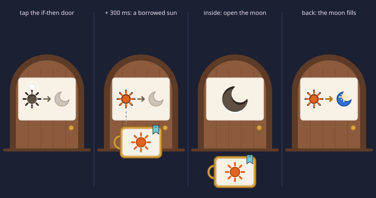

# Keys & Doors: visual and interaction design

Keys & Doors turns natural deduction into a maze. Every room has one door (the goal) and a tray of keys (the assumptions you hold). You open the door by fitting a key into a hole of the same shape. This document fixes how that looks and feels on a phone.

Scope: propositional logic with the five moves below, eight stages.

| Logic | In the game |
| --- | --- |
| Assumption use | Drop a key into the door's hole of the same shape |
| And-intro (∧I) | Fill both holes of a pair door |
| And-elim (∧E) | Drop a pair key on an empty slot: its bar snaps and you get both keys |
| If-intro (→I) | Tap an if-then door: you borrow the key its hole wants, then make its grey half |
| If-elim (→E) | Fit a key into the hole of an if-then key: its grey half fills with colour and becomes a new key |

## 1. Principles

1. **Pictures, not formulas.** No formula, letter, or word appears in normal play. A formula appears only while you long-press something (section 4.4).
2. **A key is its shape.** There are no key cards and no key bows. The sun key *is* a sun, cut out of something solid; the moon key is a moon. A door hole is the same outline recessed into the door. A key fits a hole exactly when their outlines are the same, so a perfect fit is visible at a glance, before anything is dropped.
3. **Nothing to learn but three looks.** Every part of every picture is in one of three looks, and each look means one thing everywhere:
   - **Hole** (the outline recessed: dark inside, bright lip below): *put a key of exactly this shape here.*
   - **Colour** (the shape raised, with a visible thickness): *you have this.*
   - **Grey** (the shape printed flat in grey): *you will get this once the hole next to it is filled.*

   The only other marks are an **arrow** (this hole gives that grey thing) and a **bar** that bolts two shapes together (you need both, or you hold both). Players already know arrows, cut-out shapes, and things bolted together, so no symbol needs to be taught. Player feedback showed that the earlier abstract marks (a `>` chevron for if-then and a brass ring for and) were not understood Rectangular key cards are gone for the same reason: they put a rectangle around the one thing that matters, the shape.
4. **Keys go forward, doors go backward.** Elimination rules act on keys (what you have) and make more keys. Introduction rules act on the door (what you need) and make simpler doors. Play ends when a key fits a hole of the same shape. A player never has to learn which rule applies: the object they touch decides it.
5. **One shape per proposition, everywhere.** A proposition always has the same outline, at every size and nesting depth. Compound keys are built from the outlines of their parts (section 2.3), so their outline is unique too, and so is their hole.
6. **One room per screen.** The phone shows exactly one open goal at a time. The path bar at the top shows where that room sits.
7. **Every drop is previewed.** While you hold a key over a target, the result is drawn as a ghost before you let go. A drop never does anything the preview did not show.
8. **Nothing is used up.** Keys are assumptions and stay in the tray after use. Dragging a key moves a copy; the original stays in its slot, dimmed.

## 2. Shapes

The runtime source of every key, hole, and door picture is `picture()` in `src/picture.ts`. The mockups in `docs/mockups/` are drawn by that same function, so this section, the code, and the pictures agree. All lengths below are in CSS pixels of the drawn picture.

### 2.1 Atoms

Each atom has a fixed colour **and** a fixed silhouette, so the four atoms stay distinct without colour vision. The order below is also the order in which stages introduce them.

| Atom | Silhouette | Fill | Edge | Icon |
| --- | --- | --- | --- | --- |
| P | Sun: a disc with eight slim rays | `#E0631F` | `#A8410C` | `atom-sun.svg` |
| Q | Moon: a crescent opening to the top right | `#2F6FD0` | `#1E4C96` | `atom-moon.svg` |
| R | Leaf: a pointed leaf with a stem stub | `#1E9A6C` | `#0F6A48` | `atom-leaf.svg` |
| S | Star: five sharp points | `#C2509E` | `#8A2F6E` | `atom-star.svg` |

Each silhouette is **one closed outline** on a 48 × 48 grid (`outlines` in `src/picture.ts`, the same path data as the atom icons). A key's thickness, its hole, its halo, and its fit flash are all drawn from that one path, so they can never disagree. Rules for the outlines:

- No separate strokes and no holes inside the outline: anything that is not part of the outline would not be part of the hole either. The sun's rays are part of its outline; the leaf's stem is a solid stub, not a line.
- The silhouettes differ in kind (disc with eight slim rays, crescent, leaf, five sharp points), not just in size. Every one stays recognisable at about 16 px, the size of a nested atom in a tray key on a phone.
- The box centre (24, 24) lies inside every silhouette, so a pair bar that ends there is hidden under the shape (2.3).
- Engraved marks may sit on a key's face (the leaf's vein, `marks` in `src/picture.ts`). They are decoration only: holes and grey shapes do not show them.

### 2.2 The three looks

| Look | Meaning | How it is drawn |
| --- | --- | --- |
| **Colour** | You have it | The face in the atom's fill with a 2 px edge stroke, over its **thickness**: the same outline in the edge colour, moved down by `t` (2.5) |
| **Hole** | Put a key of exactly this shape here | The same outline as a recess (2.5) |
| **Grey** | You get it when the hole beside it is filled | The same outline, flat (no thickness), in `pending` / `pending-edge` |

### 2.3 Compound keys

A compound key is built from the shapes of its parts, so its outline is as distinctive as an atom's.

| Connective | Name in game | Key (you hold it) | Hole (you need it) | Icon |
| --- | --- | --- | --- | --- |
| A ∧ B | Pair | Shape A and shape B **bolted together by a brass bar** that runs behind both | Hole A and hole B, joined by a recessed **channel** for the bar. Both holes must be filled | `conn-and.svg` |
| A → B | If-then | A cream **plate** that hugs its contents: the **hole of A**, an **arrow**, and **B in grey**. The plate's outline is its contents grown by a margin, so it follows their shapes | A **pocket**: a shallow recess with the plate's outline, with the plate's face (hole of A, arrow, grey B) printed on its floor | `conn-imp.svg` |

Why these pictures:

- **Pair** is symmetric because ∧ is. Two shapes bolted together read as "these belong together": on a key, you hold both; on a door, two holes joined by a channel read as one lock with two keyholes, and nothing opens until both are filled. When the second hole is filled, a brass bar drops into the channel (6.3).
- **If-then** is asymmetric because → is. The hole says "put A in", the arrow says "and you get", the grey says "this, which you do not have yet". Fitting A turns the grey colour: that *is* if-elim. The plate exists because the hole of A needs something solid to be cut into; it hugs its contents so that the key still has a shape of its own and no rectangle appears.
- An if-then **door** is a pocket for exactly that plate. Its floor shows the same face as the key, so it reads as "make the grey half real, given the hole's key", which is if-intro. Tapping the hole on the floor lends you its key (6.6).

**Nesting** applies the same rules inside:

- A pair inside a pair: the inner pair's bar runs between its shapes; the outer bar runs from the centre of the inner pair's box, which lies on the inner bar, so the whole key is one rigid piece (for example (P ∧ Q) ∧ R is a T of three shapes).
- A pair as A of an if-then: the hole of A is the pair's hole (two holes and a channel), cut into the plate.
- An if-then as A of an if-then: the hole of A is a pocket in the outer plate, with the inner key's face on its floor at 60% opacity. The dimmed face says "a key that looks like this goes here", not "put a sun here".
- A compound as B of an if-then: B is drawn whole in grey: a grey pair bar, or a grey plate (`pending-plate`, edge `pending-edge`) with its own grey contents.
- An if-then as a half of a pair door: that half is a pocket at full opacity (a door shows its holes plainly).

### 2.4 Layout rule (recursive)

`picture(f, w, h, goal, filled)` draws one picture in a `w × h` box. Keys draw on a transparent background; doors draw a `paper` panel (radius 6, 1 px `edge` border) and are inset by `8%` of the shorter side. Keys are inset by 2 px, and their box loses `t` px at the bottom for their thickness, `t = clamp(1.5, 5% of the shorter side, 4)`.

Inside a box `b`:

1. **Fold:** if the shorter side of `b` is under **10 px**, draw `···` in `seam` instead. Long-press shows the full formula.
2. **Atom:** the silhouette is a square of side `s = 92%` of the shorter side of `b`, centred in `b`. The 48-grid path is scaled by `s / 48`; stroke widths given in px are divided by that scale.
3. **Pair:** split `b` along its **longer** axis into two equal halves, with gap `clamp(6, 10% of the long side, 16)`, so nesting alternates between side by side and stacked on its own. The **bar** runs from the centre of the first half to the centre of the second, thickness `clamp(4, 14% of the short side, 10)`, fully rounded ends, drawn **behind** both shapes: only the part in the gap shows. Key: `brass` with a 1 px `brass-dark` edge. Hole: a recessed channel (2.5).
4. **If-then:** margin `m = clamp(2, 7% of the shorter side of b, 7)`. Inset `b` by `m`, then split it like a pair, with gap `clamp(12, 16% of the long side, 26)`. The first half holds the **hole of A**, the second **B in grey**.
   - **Arrow**, centred in the gap: shaft `max(8, gap − 4)`, open head of size `clamp(3, 33% of the shaft, 6)`, stroke `clamp(1.8, 3% of the short side, 3.5)`, round caps and joins, colour `seam`. It points right in a row and down in a column.
   - **Spine:** a band from the centre of the first half to the centre of the second, `2 ×` the arrow head size thick, so the plate stays one piece under the arrow.
   - **Plate:** the outlines of A, B, and the spine, each grown by `m`. Growing an outline by `r` is drawing it with a stroke of width `2r` in its own fill colour, with round joins; a nested if-then grows its parts by the sum of the margins on the way down. The plate is drawn twice: first grown by `m + 1.5` in `brass-dark` (the 1.5 px edge), then grown by `m` in `paper`.
5. **Doors** draw the whole proposition as a hole, keys draw it in colour. Proof-tree nodes and the stage map use the same pictures as keys and doors.

Door pictures (184 × 137) show three levels without folding. Key pictures (88 × 66 on a phone) and proof-tree nodes fold from the fourth level, for example inside (P → Q) → ((Q → R) → (P → R)).

### 2.5 Thickness and recess

Light comes from above. A key stands out of the surface, so its thickness shows as a dark band below its face. A hole is cut into the surface, so it has a dark rim inside its top edge and a bright lip below its bottom edge.

**Thickness:** the key's outline, every part in its edge colour (atom edge, `brass-dark` for bars and plates), moved down by `t` (2.4), drawn behind the face. A grey shape and a seated key have no thickness.

**Recess:** every hole is drawn from three copies of its outline (with a 1 px stroke in the same colour), offset by a depth `d`:

1. The **lip**: the outline in `lip`, moved down by `d`.
2. The **body**: the outline in `hole-shadow`.
3. The **floor**: the outline in `hole`, moved down by `1.3 d`, masked by the body. The part of the body it does not cover is the dark rim.

| Recess | Depth `d` | Body / floor |
| --- | --- | --- |
| Atom hole | `clamp(1, 5% of the shorter side of its box, 3.5)` | `hole-shadow` / `hole` |
| Pair channel | `clamp(1, 20% of the bar thickness, 2.5)` | `hole-shadow` / `hole` |
| If-then pocket | `clamp(1.5, 4% of the shorter side of its box, 4)` | `pocket-shadow` / `pocket` |

A pair hole is its channel first, then each half's hole on top, so the halves' lips cover the channel ends. Inside a grey half, recesses use the grey set (`pending-hole-shadow`, `pending-hole`, `pending-lip`, `pending-pocket-shadow`, `pending-pocket`).

### 2.6 States

`picture(f, w, h, goal, filled)` draws the static states; the in-between frames are in section 6.

| Part | State | Look |
| --- | --- | --- |
| Hole | Empty | The recess (2.5) |
| | Target: a held key fits | A **halo** under the recess: the outline grown by 3.5 px (stroke 7) in `ok`. Its opacity pulses 1 → 0.45 → 1 every 1.2 s, ease-in-out (`@keyframes glow` in `src/style.css`) |
| | Hover | The target scales to 104% and the *filled* picture is drawn over it at 50% opacity |
| | Seated | The key's face at **100%** of the hole's size, exactly over it, without thickness: it sits flush, and the hole's bright lip still shows as a hairline below it |
| Arrow | Waiting | `seam`, stroke as in 2.4 |
| | Lit | `lit`, stroke × 1.25 |
| Grey half | Waiting | Grey look |
| | Obtained | Colour look, still flat (it is printed on the plate until it lifts out, 6.1) |
| Pair channel | Waiting | Recessed channel |
| | Locked | The `brass` bar seated in the channel, flush |
| If-then pocket | Empty | Recess with the face on its floor |
| | Seated | The if-then key, as you hold it (its own hole empty, its result grey), flush |

**Paths.** `filled` lists the parts to draw as seated. A path names a part: `""` is the whole picture, `L` and `R` pick the halves of a pair, and `S` and `T` pick the hole and the result of an if-then. Paths concatenate: `TS` is the hole of the if-then in the result half. Filling a part fills everything inside it, a pair is filled when both its halves are, and filling an if-then (its path, not just its `S`) also lights its arrow and colours its result. For example, `"S"` on a sun → moon key is "sun seated, moon still grey", and `""` is "sun seated, arrow lit, moon in colour". On an if-then door, `""` keeps the pocket and lights its floor: the door is about to open.

**Hooks for animation.** The SVG marks its parts with classes:

| Class | Part |
| --- | --- |
| `.body` | A key's thickness |
| `.plate` | An if-then key's plate |
| `.slot` | The hole of an if-then |
| `.arrow` | An if-then arrow |
| `.result` | The grey half of an if-then |
| `.pair`, `.bridge` | A pair, and its bar or channel |
| `.cut` | A hole, with `data-path` set to its path. Its bounding box is the hole the seat motion (6.1) aims at |
| `.imprint` | The face on the floor of a pocket |
| `.seated` | A seated key |
| `.glow` | A halo, with `data-path` set to the path of its hole, so a pair door can light only the hole the held key fits |

Halos exist on every hole of a door (each atom and each pair, at every depth, outside pockets) and on the outermost hole of an if-then key. An if-then door has none: what fits it is a whole if-then key, so the door's outline glows instead.

### 2.7 Frames: what role a picture plays

| Frame | Meaning | Look |
| --- | --- | --- |
| Key | An assumption you hold | The shape alone, with its thickness, on the tray. No card, no rim, no bow. The tray icon `key.svg` is a brass cut-out piece |
| Door | The goal of this room | The `paper` panel mounted on an arched wooden door (`wood` / `wood-dark`) with a brass knob. The panel shows holes. Icon `door.svg` |
| Pair door | A pair goal | A door whose panel has two holes joined by a channel. Icon `door-pair.svg` |
| Open door | A cleared goal | Door leaf swung open, warm `light` inside, green check. Icon `door-open.svg` |
| Ghost | A preview of what a drop will make | Any frame at 50% opacity inside a dashed `ok` outline |
| Tree node | A step in the replayed proof | The shape in the colour look, like a key |
| Selected key | The key chosen for tap-tap | Its tray cell turns `night-3` with a 2 px white outline |

## 3. Colour

The game is played at dusk: a dark indigo room, wooden doors with warm paper panels, and keys that are bright coloured shapes. Dark surroundings make the panels and the keys the brightest things on screen, so the eye goes to the shapes.

| Token | Hex | Use |
| --- | --- | --- |
| `night` | `#1C2033` | Background |
| `night-2` | `#262B42` | Key tray, buttons |
| `night-3` | `#323857` | Pressed buttons, current stage highlight, empty states |
| `ink` | `#E8E4F0` | Icons and lines on `night` |
| `ink-2` | `#9DA3C2` | Secondary icons, path links |
| `paper` | `#F7F1E6` | Door panel, if-then plate |
| `edge` | `#D9CDB8` | Door panel border |
| `hole-shadow` | `#2E261F` | Body and outline of a hole (2.5) |
| `hole` | `#5E5143` | Floor of a hole and of a pair channel |
| `lip` | `#FFFFFF` | Bright lip below a recess |
| `pocket-shadow` / `pocket` | `#A8997E` / `#DDD0B8` | Body and floor of an if-then pocket (2.5) |
| `pending` | `#CCC4B6` | Grey shapes: what you get once a hole is filled |
| `pending-edge` | `#AFA696` | Edge of grey shapes and grey plates, waiting arrow inside a grey half |
| `pending-bar` | `#C4BCAE`, edge `#A9A092` | Grey pair bar |
| `pending-plate` | `#EEE9E0` | Grey if-then plate |
| `pending-hole-shadow` / `pending-hole` / `pending-lip` | `#9D9488` / `#BBB2A4` / `#FAF8F3` | Holes inside a grey half |
| `pending-pocket-shadow` / `pending-pocket` | `#C9C1B4` / `#E3DDD2` | Pockets inside a grey half |
| `seam` | `#6B5E4B` | Arrow, folded-pane dots, formula punctuation |
| `lit` | `#B07A1A` | Arrow once its hole is filled |
| `brass` | `#D9A441` | Pair bar, tray icon |
| `brass-dark` | `#9C7024` | Edge and thickness of pair bars and if-then plates |
| `wood` | `#8C5A3C` | Door leaf |
| `wood-dark` | `#5E3B27` | Door frame, sill |
| `light` | `#FFE7A8` | Open doorway, primary "next" button |
| `ok` | `#7CE0B5` | Valid targets, previews, success |
| `bad` | `#FF7A6B` | Rejected drop flash only (never static) |

**Scope ribbons.** Keys received from an if-intro door carry a small ribbon. The ribbon says which room they belong to (section 6.6). Ribbons use a pastel set that does not collide with the atom colours. Each ribbon also has a notch count, so it can be told apart without colour:

| Nesting | Colour | Notches |
| --- | --- | --- |
| 1st if-intro room | `#6FC7D1` teal | 1 |
| 2nd | `#F2B880` apricot | 2 |
| 3rd | `#B8A6E8` lilac | 3 |
| 4th | `#C4DB7A` lime | 4 |

## 4. Screens

All mockups use a 360 × 780 portrait viewport. Keep touch targets at least 48 × 48 and keep primary actions in the bottom half, where a thumb reaches them.

### 4.1 Stage map

- Eight doors in a 2-column grid. Each door shows its stage's goal panel, so the map also previews what is coming.
- The stage number is shown as **pips** (1 to 8 dots, in rows of four), not numerals.
- States: cleared (green check badge, and every hole of the door shows its key seated), current (raised `night-3` panel and `ok` glow on the arch), locked (dimmed, lock badge). Stages unlock in order.
- Top right: settings (`ui-settings.svg`). Tap a door to enter its stage.
- Tap the check badge of a cleared stage to rewatch its proof tree (section 4.5). The badge has a 48 × 48 hit area, and while pressed its check turns into `ui-proof-tree.svg`.

### 4.2 Room (the play screen)

From top to bottom:

1. **Path bar** (y 24 to 88). On the left, the stage-map button (`ui-stages.svg`). Then one thumbnail chip per room on the way from the stage door to the current room (section 4.3).
2. **Door** (y 100 to 430). The current goal, large and centred. Its holes are drop targets, and the holes of a pair or if-then door are also tap targets.
3. **Key tray** (y 448 to 708, `night-2`). Keys in a 3-column grid of 96 × 74 cells, in the order they were obtained. Each key is drawn as its bare shape at 88 × 66 (102 × 77 from 700 px wide, 80 × 60 below 380 px); the whole cell is its touch target. New keys are appended. When the tray holds more than six keys it scrolls vertically.
4. **Bottom bar** (y 718 to 766): undo (`ui-undo.svg`), restart room (`ui-reset.svg`), hint (`ui-hint.svg`), formula captions (`ui-formula.svg`).

The mockup shows stage 7 inside the if-intro room. The player is dragging the ribboned sun key over the sun-shaped hole of the sun → moon key. Only that key glows, because the moon → leaf key and the leaf door have no sun-shaped hole. The key shows the hover preview: the sun seated, the arrow lit, and the moon in colour, at 50%. A dashed line leads to a ghost moon key in the slot where it will land, marked with the if-elim icon. The ghost carries the same ribbon, because it is made from a ribboned key.

### 4.3 Path bar

| Chip state | Look |
| --- | --- |
| Here | Bright thumbnail inside a white outline |
| Passed through | Thumbnail dimmed 35% |
| Open sibling (from and-intro, not done yet) | Thumbnail dimmed 55%, on a branch |
| Cleared sibling | Dimmed thumbnail and green check badge |

- Chips show their room's door, so they show holes. And-intro draws a **fork**: the parent chip has two branches, one per hole of the pair door. Once a half is cleared, the parent chip shows that hole with its key seated. Tap any chip of an unfinished room to go there.
- If-intro rooms show their **ribbon** on their chip. Every key in the tray that depends on that room carries the same ribbon.
- If the chips do not fit in the width, the oldest chips collapse into one stacked chip. Tapping it expands the full path as an overlay.

### 4.4 Long-press: the formula

- Hold any picture (door, key, chip, tree node) for **450 ms**. The screen dims to 70%, the held picture stays bright with a white outline, and a paper bubble above it shows the formula.
- In the formula, each atom letter uses its atom colour; connectives and brackets use `seam`. Font: JetBrains Mono Bold, 24 px.
- The bubble stays while the finger is down and disappears on release. A long-press never starts a drag: if the finger moves more than 8 px before 450 ms, it is a drag.

### 4.5 Clear and proof-tree replay

When the last door opens:

1. The door swings open, warm light fills the screen, and a success haptic plays (section 8).
2. The view zooms out. Each room the player visited shrinks into a node, and the rooms rearrange into the proof tree: conclusion at the bottom, assumptions at the top, one horizontal bar per step. This is the standard way natural deduction trees are drawn.
3. The tree then **replays**: steps appear one at a time, in the order the player made them (about 700 ms per step).

Tree details:

- Each bar has its rule icon at its right end: `rule-assume`, `rule-and-intro`, `rule-and-elim`, `rule-imp-intro`, `rule-imp-elim`.
- Assumptions are the leaves of the tree, drawn as keys (bare shapes). Assumptions discharged by an if-intro step carry that room's ribbon, and the same ribbon sits next to the if-intro bar that discharges them. This replaces the usual `[A]¹` numbering.
- Keys the player made but never used are left out of the tree.
- Controls: step back, play/pause, step forward, plus a step scrubber (one dot per step). Top left closes the screen; top right toggles formula captions under every node. The wide `light` button at the bottom goes to the next stage.

### 4.6 Settings

Settings is the only screen that may use words, because it is reached rarely and must be unambiguous. Its options:

- Formula captions always on (also toggled with `ui-formula.svg`), for teachers and for checking your understanding.
- Left-handed tray (mirrors the bottom bar).
- Haptics on or off.
- Reduced motion (also follows the OS setting).

## 5. Gestures

| Gesture | On | Result |
| --- | --- | --- |
| Drag | Key → door it fits: any key into the hole of its own outline (an atom into its silhouette, a pair into both holes and the channel, an if-then key into the pocket of its plate) | Assumption use |
| Drag | Key → matching hole of a pair door | That half is filled (and-intro, then assumption use) |
| Drag | Key A → hole of an if-then key A → B | If-elim: new key B |
| Drag | Pair key A ∧ B → empty tray slot | And-elim: new keys A and B |
| Tap | A hole of a pair door | Enter a room whose door is that half |
| Tap | If-then door A → B | If-intro: borrow key A, enter a room with door B |
| Double tap | If-then key A → B | Enter a room whose door is A, to make the key its hole wants |
| Tap, then tap | Key, then target | Same as dragging that key to that target |
| Long-press | Any picture | Show formula (section 4.4) |
| Tap | Path chip | Go to that room |

### 5.1 Drag

- **Pick up:** touch a key and move it more than 8 px. The copy lifts (scaled to 80%, rotated −5°, with the shadow of its own outline as in 6.1) and follows the finger, offset upward so the finger never hides the picture. The original stays in its slot at 30% opacity.
- **Valid targets glow** as soon as the key is lifted: the target gets a 3 px `ok` outline, and the hole the key fits gets its pulsing halo (2.6). On a pair door, only the hole of the held key's shape glows. Invalid targets do not react. The player sees all their options before moving.
- **Hover:** when the dragged key's centre enters a valid target, the target scales to 104%, a light haptic tick plays, and the **drop-point preview** appears (section 5.3).
- **Drop on a valid target:** the action happens, and the copy flies into the target.
- **Drop elsewhere:** the copy flies back to its slot (200 ms ease-out). There is no penalty and no message.

### 5.2 Tap-tap

For one-handed play, accessibility, and players who find dragging hard:

1. Tap a key: it gets a white selection outline, and the valid targets glow exactly as during a drag. The drop-point previews are shown for **all** valid targets at once.
2. Tap a glowing target to commit. Tap the selected key again, or empty space, to cancel.

With nothing selected, tapping a door's hole means intro (section 5.4). With a key selected, tapping a door means "drop into the hole this key fits". Tapping an invalid target while a key is selected does a short shake, and the selection stays.

### 5.3 Drop-point preview

| Target | Preview while hovering |
| --- | --- |
| Door hole of the same shape | The key drawn seated in the hole at 50%; a thin line of `light` shows at the door's edge if this fills the door |
| Hole of an if-then key | The filled picture at 50% over the key (key seated, arrow lit, result in colour), a ghost of the new key in the slot where it will land, a dashed `ok` line to it, and the if-elim icon |
| Empty slot (pair key) | Ghosts of both halves in the next two free slots, with the and-elim icon |

If the result is a key that is already in the tray, the preview highlights the existing key instead of drawing a ghost. Dropping then just pulses that key; no duplicate is added.

### 5.4 Tapping a door (introduction)

- Press-and-hold feedback: on touch-down, the hole under the finger gets a 2 px `light` rim (pair door) or the hole on an if-then door's pocket floor gets the same rim. Releasing commits. Sliding off cancels.
- An atom door has no intro. Tapping it does a small wiggle, and the tray gently pulses to point at the keys.

### 5.5 Undo and restart

- Undo reverts the last action, including a room clear. Repeated undo walks back to the stage start.
- Restart room (`ui-reset.svg`) undoes every action since you entered the current room. Long-press it to restart the whole stage.

## 6. What each move looks like

Times are in milliseconds from the moment the finger lifts. Every step uses one of the four named curves in section 8 (`fly`, `out`, `in-out`, `linear`); a step with no curve named uses `out`. Steps in one table never overlap unless a row says "at the same time". The short **beats** (60 ms with nothing moving) are part of the timing, not slack.

Every scale obeys section 8: arrivals approach their final size from one side and stop; only an emphasis pulse may go past its resting size, by at most 4%, once.

### 6.1 The seat: a key goes into its hole

Every time a key goes into a hole (a door hole, a half of a pair door, the hole of an if-then key, an if-then pocket) it makes the same motion. Because the key and the hole share one outline, the motion is designed to show that the outlines coincide.

| Time (ms) | Phase | What moves |
| --- | --- | --- |
| 0 to 220 | **Fly** | The dragged copy flies to the hole's centre (`fly`), rotation −5° → 0°, until its face is **104% of the seated size**. The thickness and halo fade out over 0 to 160 (`linear`), so only the coloured face arrives |
| 220 to 340 | **Key settles** | The face shrinks 104% → 100% of the seated size and moves down by the hole's depth `d` (2.5), sinking flush (`out`). Medium haptic at 220, the moment of contact. At 340 the copy is removed and the picture is redrawn seated, with identical pixels |

Implementation notes:

- The pose and size come from the target's `.cut[data-path="…"]` (2.6), without its `.glow` children. The seated size is 100% of the hole (2.6); the static seated face supplies the arrival geometry.
- A pair key going into a pair hole, and an if-then key going into a pocket, seat as one piece with the same timings.
- A key never moves towards a hole of another outline: such holes do not glow, and a drop there flies the copy back to its slot (200 ms ease-out, section 5.1). The player learns the fit from the outlines, not from an error.

The result of an if-then gains its thickness during delivery (6.2). A borrowed key rises directly into the tray (6.6), without an overshoot or an extra lift beat.

### 6.2 Fitting a key into an if-then key (if-elim)

The runtime motion is `fitMotion()` in `src/motion.ts`, which follows the table below.

The player drops key A on an if-then key A → B.

| Time (ms) | What moves |
| --- | --- |
| 0 to 340 | Fly and Key settles (6.1). Afterwards the key shows `filled: ["S"]` |
| 340 to 400 | Beat: nothing moves |
| 400 to 620 | **Arrow lights**: a `lit` copy of `.arrow` (stroke × 1.25), with `pathLength="1"`, `stroke-dasharray: 1`, `stroke-dashoffset` 1 → 0, drawn tail to head (`in-out`) |
| 620 to 680 | Beat: nothing moves |
| 680 to 920 | **Result fills with colour**: the coloured `.result` from `filled: [""]` fades in over the grey one, opacity 0 → 1 (`out`). Nothing changes size |
| 920 to 1160 | **Result is obtained**: redraw `filled: [""]`. The `.result` pulses 1 → 1.04 → 1, peak at 1040 (`in-out`). Light haptic at 920. A four-point `light` sparkle at its top right grows 0 → 1 over 920 to 1040 (`out`) and fades over 1040 to 1160 (`linear`) |
| 1160 to 1460 | **Delivered**: a coloured result copy moves to its tray slot (`in-out`), scaling to the tray key size. Its thickness fades in over 1340 to 1460 (`out`). At the same time, over 1160 to 1360, the if-then key cross-fades back to its empty state (`out`), because keys are never used up |

Total: 1460 ms. If key B is already in the tray, the Delivered copy moves to that key and disappears into it. That key then pulses 1 → 1.04 → 1 over 1460 to 1700 (`in-out`); no duplicate is added. Both input keys stay.

**Input during the animation.** The state changes at 0; the animation only shows it. A new touch anywhere jumps every running animation to its end state at once, and the touch is then handled as normal. Undo works the same way.

### 6.3 Filling a pair door (and-intro)

The runtime motion is `fitMotion()` in `src/motion.ts`, which follows the timings below.

Under the hood, filling a hole is and-intro followed by assumption use in that half's room; the view stays on the pair door.

**First hole:** Fly and Key settles (6.1), 0 to 340. Medium haptic at 220. At 340 redraw that hole seated (`filled: ["L"]` or `["R"]`). Nothing else moves: the other hole stays empty, and the action ends at 340.

**Last hole:**

| Time (ms) | What moves |
| --- | --- |
| 0 to 340 | Fly and Key settles. Medium haptic at 220 |
| 340 to 400 | Beat: nothing moves |
| 400 to 620 | **Bar locks**: the flush `brass` bar grows inside the channel from its centre outward to both ends (`out`). Scale along the channel's long axis 0 → 1 about its centre; across the channel it is full size throughout. No overshoot |
| 620 | Redraw `filled: [""]`. Medium haptic |
| 620 to 680 | Beat: nothing moves |
| 680 | The door opens as in 6.5, with 680 as its start |

**A hole the player cannot fill directly:** tapping it zooms into that hole (300 ms, `in-out`), and the room's door becomes that half. The path bar forks. On clearing that room, zoom back out (300 ms, `in-out`), then after a 60 ms beat the made shape fades in at 104% of the seated size and settles as in 6.1 (120 ms, `out`, medium haptic). If it was the last hole, Bar locks follows after a 60 ms beat.

### 6.4 Snapping a pair key (and-elim)

| Time (ms) | What moves |
| --- | --- |
| 0 to 150 | The dragged pair key flies onto the empty slot |
| 150 to 250 | The bar snaps in the middle: a white sparkle at the break, and the two shapes, each keeping a stub of the bar, tilt ±12° and move 4 px apart |
| 250 to 550 | The stubs fade out (100 ms) and the two shapes fly to the next two free slots, each scaling to the tray key size |

The pair key stays in its slot.

### 6.5 Opening a door (assumption use)

Fly and Key settles as in 6.1 (0 to 340), then a 60 ms beat. The door swings open over 400 to 800 (`in-out`) and light spills out: the `light` glow behind the leaf fades in over 500 to 800 (`out`). The success haptic plays at 800 if this clears the stage. The room is cleared: go to the next open sibling room on the path, or up to the parent. Clearing the stage's own door clears the stage.

### 6.6 Going through an if-then door (if-intro)

| Time (ms) | What moves |
| --- | --- |
| 0 to 300 | The hole hands out a **borrowed key**: a key of its shape rises out of the hole (scale 0.6 → 1) and flies into the tray. A new ribbon wipes onto it (150 ms). The hole shows that key seated |
| 300 to 600 | The camera zooms into the grey half until it fills the door panel (ease-in-out). On the way the grey shape cross-fades into a hole of the same outline: the thing you will get becomes the thing you must make. This is the new room's door. The path adds a ribboned chip |
| On clearing that room | Zoom back out (300 ms, `in-out`). Then the Arrow lights, Result fills with colour, and Result is obtained steps of 6.2 run with their beats (a 60 ms beat, 220, 60, 240, 240 ms), then after a 60 ms beat the door opens as in 6.5 |

**Scope.** A tray belongs to a room. Child rooms start with a copy of their parent's tray. Keys made in a room never flow back to the parent. A key made from ribboned keys carries all of their ribbons. When an if-intro room is cleared, its ribboned keys dissolve from view (scale to 0 with a sparkle, 250 ms), which shows that the borrowed key is given back.

### 6.7 Reduced motion

Flights and camera moves become 150 ms cross-fades (`linear`). Seating, the arrow, the colour fill, and the pair bar appear together in one 150 ms cross-fade from the empty to the filled picture. Nothing changes size: pulses, the settle, and the bar growth are dropped. Haptics stay.

## 7. Feedback without words

### 7.1 Hints

The hint button never shows text. One press pulses the key and the target of a useful next move together, for 2 s. Three hints in the same room show a ghost hand performing the move, using `gesture-drag.svg` or `gesture-tap.svg`.

### 7.2 Tutorials

Stages 1 to 6 each introduce exactly one new move. On first entry, a ghost hand performs that move once. Afterwards the hand loops every 6 s until the player touches anything. Tutorials are never blocking.

### 7.3 Formula captions

`ui-formula.svg` in the bottom bar toggles a small formula caption under every picture on screen. It is off by default. While it is on, the button stays in its pressed state (`night-3`).

## 8. Motion and haptics

- Curves: `fly` = `cubic-bezier(.2, .8, .2, 1)`; `out` = `cubic-bezier(.22, 1, .36, 1)`; `in-out` = `cubic-bezier(.65, 0, .35, 1)`; `linear` = `linear`. None overshoots.
- Arrivals never pass their final size. Only an emphasis pulse may pass its resting size: 1 → 1.04 → 1 once, peak at the middle. Hover at 104% is a held state. Looping signals change opacity or outline, never scale.
- Durations: a step lasts 120 to 300 ms, separated by 60 ms beats. No action takes longer than 1.7 s before the board is calm again.
- Haptics: light tick (valid target entered), medium (action committed), success pattern (stage cleared), soft double knock (invalid tap while a key is selected). Never vibrate on a plain miss.
- Reduced motion: see 6.7. The tree replay shows the complete tree at once.

## 9. Accessibility

- Atoms differ by silhouette, ribbons differ by notch count, and valid targets get an outline, not just a colour change. Every state can be read without colour vision: a hole differs from a held shape by its recess (dark rim and lip) against the key's thickness (dark band below), and grey differs from colour by lightness as well as hue, and by having no thickness.
- Every key, door, and node has an accessible label with its formula, read in words ("if sun then moon"). Screen-reader users play with tap-tap.
- Touch targets are at least 48 × 48.
- Contrast: in the formula bubble, every colour on `paper` is at least 3.1:1 (sun is the lowest at 3.13, `seam` is 5.6), which meets WCAG AA for large text (the bubble uses 24 px bold). `ink` on `night` is 12.9:1, and `ink-2` on `night` is 6.5:1.

## 10. Proposed stages

The stage list belongs to level design. This proposal shows that the visual system covers it: each stage introduces at most one new move, and the atoms appear in their table order.

| # | Keys | Door | New move |
| --- | --- | --- | --- |
| 1 | P, Q | P | Assumption use |
| 2 | P, Q | P ∧ Q | And-intro |
| 3 | P ∧ Q | Q | And-elim |
| 4 | P ∧ Q | Q ∧ P | (combine) |
| 5 | P → Q, P | Q | If-elim |
| 6 | Q | P → P | If-intro, ribbons |
| 7 | P → Q, Q → R | P → R | (combine) |
| 8 | P → (Q → R) | (P ∧ Q) → R | (all five) |

## 11. Asset inventory

All icons live in `src/assets/icons/`. Every file has a `<title>` for accessibility.

| Group | Grid | Colour | Files |
| --- | --- | --- | --- |
| Atoms | 48 | Fixed (section 2.1) | `atom-sun`, `atom-moon`, `atom-leaf`, `atom-star` |
| Connectives | 48 | `currentColor` | `conn-and`, `conn-imp` |
| Game objects | 48 | Fixed (brass, wood, paper) | `key` (a brass cut-out piece, not any atom), `door`, `door-pair`, `door-open` |
| Rules | 24 | `currentColor` | `rule-assume`, `rule-and-intro`, `rule-and-elim`, `rule-imp-intro`, `rule-imp-elim` |
| UI | 24 | `currentColor` | `ui-undo`, `ui-reset`, `ui-stages`, `ui-hint`, `ui-formula`, `ui-proof-tree`, `ui-play`, `ui-pause`, `ui-step-forward`, `ui-step-back`, `ui-check`, `ui-close`, `ui-lock`, `ui-settings` |
| Gesture ghosts | 24 | `currentColor` | `gesture-tap`, `gesture-hold`, `gesture-drag` |

Conventions for `currentColor` icons: stroke width 2 on the 24 grid (2.5 on the 48 grid), round caps and joins, no fills except for small solid accents.

The SVGs in `docs/mockups/` are illustrations for this document, built from the same icons and from `picture()` itself. They are not runtime assets.

The connective icons follow the three looks in one colour: a hole is an outline with a thick inner rim at the top, a held shape is solid, and a grey shape is solid at 35% opacity. The atom icons are drawn like keys: the face over its thickness (the outline in the edge colour, 2.6 units down), at 92% of the grid.

## 12. Reserved for later

These are not part of the current scope. They are listed so that new pictures do not collide with the current ones. The arrow, the bolted bar, and the hugging plate are taken:

- **Or (∨):** two shapes side by side with **no** bar, hanging from a **fork** (a Y-shaped split): one of the two, not both.
- **Falsum (⊥):** a **cracked** blank token: a disc with a jagged crack through it.
- **Not (¬A):** drawn as A → ⊥, an if-then whose grey half is the cracked token, so it needs no picture of its own.
