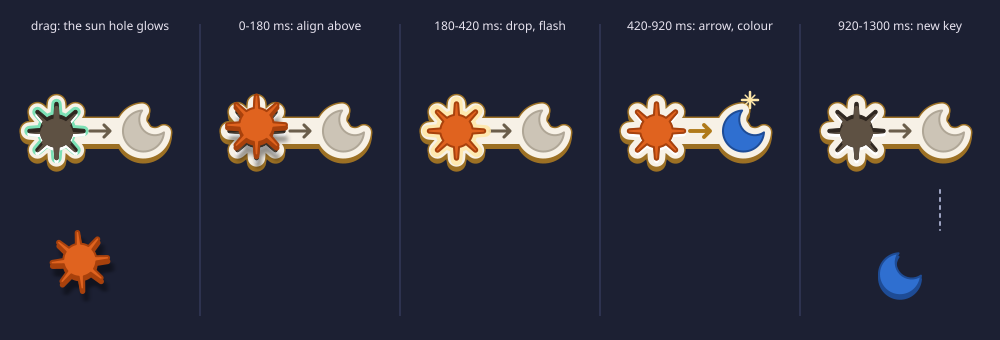
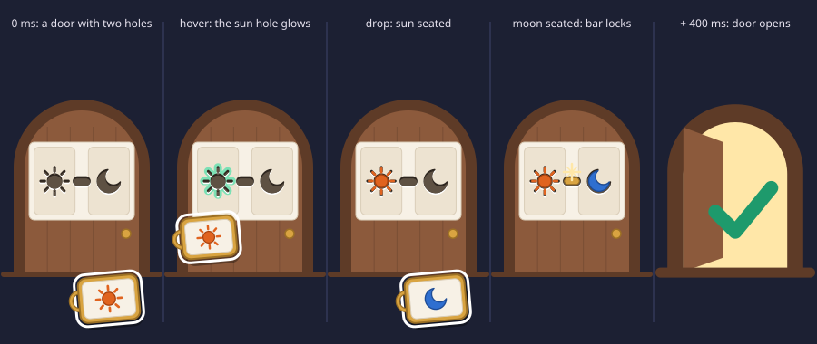

# Keys & Doors: visual and interaction design

Keys & Doors turns natural deduction into a maze. Every room has one door (the goal) and a tray of keys (the assumptions you hold). You open the door by fitting a key into a hole of the same shape. This document fixes how that looks and feels on a phone.

Scope: propositional logic with the five moves below, eight stages.

| Logic | In the game |
| --- | --- |
| Assumption use | Drop a key into the door's hole of the same shape |
| And-intro (∧I) | Fill both holes of a pair door |
| And-elim (∧E) | Drop a pair key on an empty slot: its bar snaps and you get both keys |
| If-intro (→I) | Tap an if-then door: you borrow the key its hole wants, then make its grey half |
| If-elim (→E) | Fit a key into the hole of an if-then key: its grey half fills with colour and becomes a new key |

## 1. Principles

1. **Pictures, not formulas.** No formula, letter, or word appears in normal play. A formula appears only while you long-press something (section 4.4).
2. **Nothing to learn but three looks.** Every part of every card is in one of three looks, and each look means one thing everywhere:
   - **Hole** (a dark recess cut into the card): *put a key of this shape here.*
   - **Colour** (a raised, coloured shape): *you have this.*
   - **Grey** (a flat, greyed shape): *you will get this once the hole next to it is filled.*

   The only other marks are an **arrow** (this hole gives that grey thing) and a **bar** that bolts two tiles together (you need both, or you hold both). Players already know arrows, keyholes, and things bolted together, so no symbol needs to be taught. Player feedback showed that the earlier abstract marks (a `>` chevron for if-then and a brass ring for and) were not understood.
3. **Keys go forward, doors go backward.** Elimination rules act on keys (what you have) and make more keys. Introduction rules act on the door (what you need) and make simpler doors. Play ends when a key fits a hole of the same shape. A player never has to learn which rule applies: the object they touch decides it.
4. **One shape per proposition, everywhere.** A proposition always has the same shape. A key shows it in colour; a door shows the same shape cut out as a hole. Matching is always "this key fits this hole".
5. **One room per screen.** The phone shows exactly one open goal at a time. The path bar at the top shows where that room sits.
6. **Every drop is previewed.** While you hold a key over a target, the result is drawn as a ghost before you let go. A drop never does anything the preview did not show.
7. **Nothing is used up.** Keys are assumptions and stay in the tray after use. Dragging a key moves a copy; the original stays in its slot, dimmed.

## 2. Picture cards

The runtime source of every card is `picture()` in `src/picture.ts`. The mockups in `docs/mockups/` are drawn by that same function, so this section, the code, and the pictures agree.

### 2.1 Atoms

Each atom has a fixed colour **and** a fixed silhouette, so the four atoms stay distinct without colour vision. The order below is also the order in which stages introduce them.

| Atom | Picture | Fill | Outline | Icon |
| --- | --- | --- | --- | --- |
| P | Sun | `#E0631F` | `#A8410C` | `atom-sun.svg` |
| Q | Moon | `#2F6FD0` | `#1E4C96` | `atom-moon.svg` |
| R | Leaf | `#1E9A6C` | `#0F6A48` | `atom-leaf.svg` |
| S | Star | `#C2509E` | `#8A2F6E` | `atom-star.svg` |

The silhouettes differ in kind (round with rays, crescent, pointed oval, five points), not just in size. Each one is still recognisable at 10 px, and each is just as recognisable as a hole, because a hole keeps the exact outline.

### 2.2 The three looks

| Look | Meaning | How it is drawn |
| --- | --- | --- |
| **Colour** | You have it | The atom's fill and outline from 2.1 |
| **Hole** | Put a key of this shape here | A recess with the exact outline of the key: see 2.4 |
| **Grey** | You get it when the hole beside it is filled | The same shape in `pending` / `pending-edge`; tiles in `pending-plate` |

### 2.3 Compound cards

A compound card is split into two halves. What sits between them is the connective.

| Connective | Name in game | Key (you hold it) | Door (you need it) | Icon |
| --- | --- | --- | --- | --- |
| A ∧ B | Pair | Two tiles, A and B in colour, **bolted together by a brass bar** | The same two tiles, each with a **hole**, joined by a **recessed channel** where the bar will sit. Both holes must be filled | `conn-and.svg` |
| A → B | If-then | Left: a **hole shaped exactly like key A**. Middle: an **arrow**. Right: **B in grey** | The same picture. The door opens when its grey half has been made real (if-intro, section 6) | `conn-imp.svg` |

Why these pictures:

- **Pair** is symmetric because ∧ is. A bar bolting two tiles reads as "these belong together": on a key, you hold both; on a door, the two holes and the channel between them read as one lock with two keyholes, and nothing opens until both are filled. When the second hole is filled, a brass bar drops into the channel.
- **If-then** is asymmetric because → is. The hole says "put A in", the arrow says "and you get", the grey says "this, which you do not have yet". Fitting A turns the grey colour: that *is* if-elim.
- On an if-then **door** the same picture means "make the grey half real, given the hole's key", which is if-intro. Tapping the hole lends you its key (section 6).

### 2.4 Layout rule (recursive)

A card of width `w` and height `h` is drawn like this:

1. Fill the card with `paper` and an `edge` border, and pad by `7%` of the shorter side.
2. **Atom:** draw the silhouette centred, at `92%` of the shorter side of its box.
3. **Compound:** split along the **longer** axis into two **equal** halves, so nesting alternates between side by side and stacked on its own.
   - **Pair:** gap = `clamp(8, 14% of the long side, 22)`. Each half is a **tile**: a rounded rectangle (radius `12%` of its shorter side, fill alternating `paper` / `paper-2` by depth, `edge` border) padded by `7%`. The **bar** spans the gap and overlaps each tile by 2 px; thickness `t = clamp(5, 13% of the short side, 12)`, fully rounded ends. On a key the bar is `brass` with a 1 px `brass-dark` border. On a door it is a recessed channel (2.5).
   - **If-then:** gap = `clamp(12, 16% of the long side, 26)`. The **arrow** is centred in the gap: shaft length `max(8, gap - 4)`, open head of size `clamp(3.5, 35% of the length, 7)`, stroke `clamp(2, 3.5% of the short side, 4)`, round caps, colour `seam`. It points right in a row and down in a column. The first half holds the **hole of A**. The second half holds **B in grey**; a compound B sits on a grey tile (`pending-plate`, `pending-edge`).
4. **The hole of A** has the exact outline of key A:
   - atom: the silhouette as a recess;
   - pair: the pair's two tiles with holes in them, joined by a recessed channel;
   - if-then: a rectangular recess (radius 6) the size of the whole half, holding an **imprint** of the A key card (inset `8%`, at `55%` opacity), so the player can see which key goes there.
5. **Doors** draw their proposition as *need*: an atom is a hole, a pair is tiles with holes and a channel, and an if-then looks the same as on a key. **Keys** and proof-tree nodes draw it as *have*: atoms in colour, pairs with a brass bar.
6. **Folding:** if a half would make its symbols smaller than **10 px**, draw `···` in `seam` instead. Long-press shows the full formula.

Door cards (184 × 137) show three levels without folding. Key cards (88 × 66 inside the rim) and proof-tree nodes fold from the fourth level, for example inside (P → P) ∧ (Q → (P → Q)).

### 2.5 How a recess is drawn

Light comes from above, so a hole has a dark rim inside its top edge and a bright lip below its bottom edge. Every recess (atom hole, channel, if-then slot) is drawn from three copies of its shape, offset by a depth `d`:

1. The **lip**: the shape in `lip`, moved down by `d`.
2. The **body**: the shape in `hole-shadow`, outlined in the same colour.
3. The **floor**: the shape in `hole`, moved down by `1.3 d`, masked by the body. The part of the body it does not cover is the dark rim.

| Recess | Depth `d` | Body / floor |
| --- | --- | --- |
| Atom hole | `clamp(1, 5% of the silhouette size, 3.5)` | `hole-shadow` / `hole` |
| Pair channel | `clamp(1, 20% of t, 2.5)` | `hole-shadow` / `hole` |
| If-then slot | `clamp(1.5, 4% of the short side, 4)` | `hole` / `recess` |

Inside a grey half, recesses use the grey set (`pending-hole-shadow`, `pending-hole`, `pending-lip`).

### 2.6 States

Every part has the states below. `picture(f, w, h, goal, filled)` draws the static ones; the in-between frames are in section 6.

| Part | State | Look |
| --- | --- | --- |
| Hole | Empty | The recess (2.5) |
| | Target: a held key fits | Add a halo: the same shape in `ok`, stroke widened by 6 px, under the recess. Its opacity pulses 1 → 0.45 → 1 every 1.2 s, ease-in-out (`@keyframes glow` in `src/style.css`) |
| | Hover | The target scales to 104% and the *filled* picture is drawn over the card at 50% opacity |
| | Seated | The recess stays, and the key's coloured shape sits in it at 90% of the hole's size, so a dark rim shows all round |
| Arrow | Waiting | `seam`, stroke as in 2.4 |
| | Lit | `lit`, stroke ×1.25 |
| Grey half | Waiting | Grey look |
| | Obtained | Colour look |
| Pair bar on a door | Waiting | Recessed channel |
| | Locked | A `brass` bar inset by 12% of `t`, seated in the channel |
| If-then slot (compound A) | Empty | Recess with the 55% imprint |
| | Seated | The A key card at full opacity on `paper`, inset 8% |

**Paths.** `filled` lists the parts to draw as seated. A path names a part of the card: `""` is the whole card, `L` and `R` pick the halves of a pair, and `S` and `T` pick the hole and the result of an if-then. Paths concatenate: `TS` is the hole of the if-then in the result half. Filling a part fills everything inside it, and filling an if-then (its path, not just its `S`) also lights its arrow and colours its result. For example, `"S"` on a sun → moon key is "sun seated, moon still grey", and `""` is "sun seated, arrow lit, moon in colour".

**Hooks for animation.** The SVG marks its parts with classes: `.slot` (the hole of an if-then), `.arrow`, `.result` (the grey half), `.pair`, `.bridge` (the bar or channel), `.cut` (any recess), `.seated` (a seated key), and `.glow` (halos). Each `.glow` has `data-path` set to the path of its hole, so a pair door can light only the hole the held key fits. Halos exist on the holes of a door's atoms and pairs and on the outermost hole of an if-then key. An if-then door has none: what fits it is a whole if-then key, so the door's outline glows instead.

### 2.7 Frames: what role a card plays

| Frame | Meaning | Look |
| --- | --- | --- |
| Key | An assumption you hold | Card in a brass rim (`brass` / `brass-dark`) with a round bow on its left edge. Icon `key.svg` |
| Door | The goal of this room | Card mounted on an arched wooden door (`wood` / `wood-dark`) with a brass knob. The card shows holes. Icon `door.svg` |
| Pair door | A pair goal | A door whose card has two holes joined by a channel. Icon `door-pair.svg` |
| Open door | A cleared goal | Door leaf swung open, warm `light` inside, green check. Icon `door-open.svg` |
| Ghost | A preview of what a drop will make | Any frame at 50% opacity inside a dashed `ok` outline |
| Tree node | A step in the replayed proof | Bare card in the colour look; assumptions keep their brass rim |

## 3. Colour

The game is played at dusk: a dark indigo room, warm paper cards, brass keys, wooden doors. Dark surroundings make the light cards the brightest thing on screen, so the eye goes to the pictures.

| Token | Hex | Use |
| --- | --- | --- |
| `night` | `#1C2033` | Background |
| `night-2` | `#262B42` | Key tray, buttons |
| `night-3` | `#323857` | Pressed buttons, current stage highlight, empty states |
| `ink` | `#E8E4F0` | Icons and lines on `night` |
| `ink-2` | `#9DA3C2` | Secondary icons, path links |
| `paper` | `#F7F1E6` | Card face, depth 0, 2, ... |
| `paper-2` | `#EDE3D1` | Card face, depth 1, 3, ... |
| `edge` | `#D9CDB8` | Card border |
| `hole-shadow` | `#2E261F` | Body and outline of a hole (2.5) |
| `hole` | `#5E5143` | Floor of a hole and of a pair channel |
| `lip` | `#FFFFFF` | Bright lip below a recess |
| `recess` | `#E2D6C1` | Floor of an if-then slot that takes a compound key |
| `pending` | `#CCC4B6` | Grey shapes: what you get once a hole is filled |
| `pending-edge` | `#AFA696` | Outline of grey shapes and tiles, waiting arrow inside a grey half |
| `pending-plate` | `#EEE9E0`, `#E6E0D5` | Grey tiles, by depth |
| `pending-hole-shadow` / `pending-hole` / `pending-lip` | `#9D9488` / `#BBB2A4` / `#FAF8F3` | Holes inside a grey half |
| `seam` | `#6B5E4B` | Arrow, folded-pane dots, formula punctuation |
| `lit` | `#B07A1A` | Arrow once its hole is filled |
| `brass` | `#D9A441` | Keys, pair bar |
| `brass-dark` | `#9C7024` | Key outline, pair bar border |
| `wood` | `#8C5A3C` | Door leaf |
| `wood-dark` | `#5E3B27` | Door frame, sill |
| `light` | `#FFE7A8` | Open doorway, primary "next" button |
| `ok` | `#7CE0B5` | Valid targets, previews, success |
| `bad` | `#FF7A6B` | Rejected drop flash only (never static) |

**Scope ribbons.** Keys received from an if-intro door carry a small ribbon. The ribbon says which room they belong to (section 6.5). Ribbons use a pastel set that does not collide with the atom colours. Each ribbon also has a notch count, so it can be told apart without colour:

| Nesting | Colour | Notches |
| --- | --- | --- |
| 1st if-intro room | `#6FC7D1` teal | 1 |
| 2nd | `#F2B880` apricot | 2 |
| 3rd | `#B8A6E8` lilac | 3 |
| 4th | `#C4DB7A` lime | 4 |

## 4. Screens

All mockups use a 360 × 780 portrait viewport. Keep touch targets at least 48 × 48 and keep primary actions in the bottom half, where a thumb reaches them.

### 4.1 Stage map

- Eight doors in a 2-column grid. Each door shows its stage's goal card, so the map also previews what is coming.
- The stage number is shown as **pips** (1 to 8 dots, in rows of four), not numerals.
- States: cleared (green check badge, and every hole of the door shows its key seated), current (raised `night-3` panel and `ok` glow on the arch), locked (dimmed, lock badge). Stages unlock in order.
- Top right: settings (`ui-settings.svg`). Tap a door to enter its stage.
- Tap the check badge of a cleared stage to rewatch its proof tree (section 4.5). The badge has a 48 × 48 hit area, and while pressed its check turns into `ui-proof-tree.svg`.

### 4.2 Room (the play screen)

From top to bottom:

1. **Path bar** (y 24 to 88). On the left, the stage-map button (`ui-stages.svg`). Then one thumbnail chip per room on the way from the stage door to the current room (section 4.3).
2. **Door** (y 100 to 430). The current goal, large and centred. Its holes are drop targets, and the holes of a pair or if-then door are also tap targets.
3. **Key tray** (y 448 to 708, `night-2`). Keys in a 3-column grid, 96 × 74 each, in the order they were obtained. New keys are appended. When the tray holds more than six keys it scrolls vertically.
4. **Bottom bar** (y 718 to 766): undo (`ui-undo.svg`), restart room (`ui-reset.svg`), hint (`ui-hint.svg`), formula captions (`ui-formula.svg`).

The mockup shows stage 7 inside the if-intro room. The player is dragging the ribboned sun key over the sun-shaped hole of the sun → moon key. Only that key glows, because the moon → leaf key and the leaf door have no sun-shaped hole. Its card shows the hover preview: the sun seated, the arrow lit, and the moon in colour, at 50%. A dashed line leads to a ghost moon key in the slot where it will land, marked with the if-elim icon. The ghost carries the same ribbon, because it is made from a ribboned key.

### 4.3 Path bar

| Chip state | Look |
| --- | --- |
| Here | Bright thumbnail inside a white outline |
| Passed through | Thumbnail dimmed 35% |
| Open sibling (from and-intro, not done yet) | Thumbnail dimmed 55%, on a branch |
| Cleared sibling | Dimmed thumbnail and green check badge |

- Chips show their room's door, so they show holes. And-intro draws a **fork**: the parent chip has two branches, one per hole of the pair door. Once a half is cleared, the parent chip shows that hole with its key seated. Tap any chip of an unfinished room to go there.
- If-intro rooms show their **ribbon** on their chip. Every key in the tray that depends on that room carries the same ribbon.
- If the chips do not fit in the width, the oldest chips collapse into one stacked chip. Tapping it expands the full path as an overlay.

### 4.4 Long-press: the formula

- Hold any card (door, key, chip, tree node) for **450 ms**. The screen dims to 70%, the held card stays bright with a white outline, and a paper bubble above it shows the formula.
- In the formula, each atom letter uses its atom colour; connectives and brackets use `seam`. Font: JetBrains Mono Bold, 24 px.
- The bubble stays while the finger is down and disappears on release. A long-press never starts a drag: if the finger moves more than 8 px before 450 ms, it is a drag.

### 4.5 Clear and proof-tree replay

When the last door opens:

1. The door swings open, warm light fills the screen, and a success haptic plays (section 8).
2. The view zooms out. Each room the player visited shrinks into a node, and the rooms rearrange into the proof tree: conclusion at the bottom, assumptions at the top, one horizontal bar per step. This is the standard way natural deduction trees are drawn.
3. The tree then **replays**: steps appear one at a time, in the order the player made them (about 700 ms per step).

Tree details:

- Each bar has its rule icon at its right end: `rule-assume`, `rule-and-intro`, `rule-and-elim`, `rule-imp-intro`, `rule-imp-elim`.
- Assumptions keep their brass rim. Assumptions discharged by an if-intro step carry that room's ribbon, and the same ribbon sits next to the if-intro bar that discharges them. This replaces the usual `[A]¹` numbering.
- Keys the player made but never used are left out of the tree.
- Controls: step back, play/pause, step forward, plus a step scrubber (one dot per step). Top left closes the screen; top right toggles formula captions under every node. The wide `light` button at the bottom goes to the next stage.

### 4.6 Settings

Settings is the only screen that may use words, because it is reached rarely and must be unambiguous. Its options:

- Formula captions always on (also toggled with `ui-formula.svg`), for teachers and for checking your understanding.
- Left-handed tray (mirrors the bottom bar).
- Haptics on or off.
- Reduced motion (also follows the OS setting).

## 5. Gestures

| Gesture | On | Result |
| --- | --- | --- |
| Drag | Key → door it fits: an atom key into the hole of its shape, a pair key into both holes, an if-then key onto the same if-then picture | Assumption use |
| Drag | Key → matching hole of a pair door | That half is filled (and-intro, then assumption use) |
| Drag | Key A → hole of an if-then key A → B | If-elim: new key B |
| Drag | Pair key A ∧ B → empty tray slot | And-elim: new keys A and B |
| Tap | A hole of a pair door | Enter a room whose door is that half |
| Tap | If-then door A → B | If-intro: borrow key A, enter a room with door B |
| Double tap | If-then key A → B | Enter a room whose door is A, to make the key its hole wants |
| Tap, then tap | Key, then target | Same as dragging that key to that target |
| Long-press | Any card | Show formula (section 4.4) |
| Tap | Path chip | Go to that room |

### 5.1 Drag

- **Pick up:** touch a key and move it more than 8 px. The copy lifts (scaled to 80%, rotated −5°, with a drop shadow) and follows the finger, offset upward so the finger never hides the picture. The original stays in its slot at 30% opacity.
- **Valid targets glow** as soon as the key is lifted: the target gets a 3 px `ok` outline, and the hole the key fits gets its pulsing halo (2.6). On a pair door, only the hole of the held key's shape glows. Invalid targets do not react. The player sees all their options before moving.
- **Hover:** when the dragged key's centre enters a valid target, the target scales to 104%, a light haptic tick plays, and the **drop-point preview** appears (section 5.3).
- **Drop on a valid target:** the action happens, and the copy flies into the target.
- **Drop elsewhere:** the copy flies back to its slot (200 ms ease-out). There is no penalty and no message.

### 5.2 Tap-tap

For one-handed play, accessibility, and players who find dragging hard:

1. Tap a key: it gets a white selection outline, and the valid targets glow exactly as during a drag. The drop-point previews are shown for **all** valid targets at once.
2. Tap a glowing target to commit. Tap the selected key again, or empty space, to cancel.

With nothing selected, tapping a door's hole means intro (section 5.4). With a key selected, tapping a door means "drop into the hole this key fits". Tapping an invalid target while a key is selected does a short shake, and the selection stays.

### 5.3 Drop-point preview

| Target | Preview while hovering |
| --- | --- |
| Door hole of the same shape | The key drawn seated in the hole at 50%; a thin line of `light` shows at the door's edge if this fills the door |
| Hole of an if-then key | The filled picture at 50% over the key (key seated, arrow lit, result in colour), a ghost of the new key in the slot where it will land, a dashed `ok` line to it, and the if-elim icon |
| Empty slot (pair key) | Ghosts of both halves in the next two free slots, with the and-elim icon |

If the result is a key that is already in the tray, the preview highlights the existing key instead of drawing a ghost. Dropping then just pulses that key; no duplicate is added.

### 5.4 Tapping a door (introduction)

- Press-and-hold feedback: on touch-down, the hole under the finger gets a 2 px `light` rim (pair door) or a crack of `light` opens round the if-then door's hole. Releasing commits. Sliding off cancels.
- An atom door has no intro. Tapping it does a small wiggle, and the tray gently pulses to point at the keys.

### 5.5 Undo and restart

- Undo reverts the last action, including a room clear. Repeated undo walks back to the stage start.
- Restart room (`ui-reset.svg`) undoes every action since you entered the current room. Long-press it to restart the whole stage.

## 6. What each move looks like

Times are in milliseconds from the moment the finger lifts. Every step uses one of the four named curves in section 8 (`fly`, `out`, `in-out`, `linear`); a step with no curve named uses `out`. Steps in one table never overlap unless a row says "at the same time": one thing moves at a time, so a player on a small screen can follow cause and effect. The short **beats** (60 ms with nothing moving) are part of the timing, not slack.

Every scale in this section obeys the overshoot rule of section 8: arrivals approach their final size from one side and stop, and only an emphasis pulse may go past its resting size, by at most 4%, once.

### 6.1 Fitting a key (if-elim)

The player drops key A on an if-then key A → B.

"Seated size" below is the size of the `.seated` shape: 90% of the hole (2.6).

| Time (ms) | Step | What moves | Curve |
| --- | --- | --- | --- |
| 0 to 220 | **Fly** | The dragged copy moves to the centre of the hole and shrinks from 80% of a key card until its shape is **104% of the seated size**. Its rotation goes from −5° to 0°. Its card (rim, bow, paper) fades out over 0 to 160 (`linear`), so only the coloured shape arrives. The hole's halo fades out over the same 0 to 160 | `fly` |
| 220 to 340 | **Key settles** | The shape shrinks 104% → 100% of the seated size and moves down by the hole's depth `d` (2.5), so it sinks into the recess. Medium haptic at 220, the moment of contact. At 340 the copy is removed and the card is redrawn with `filled: ["S"]`, which draws the same pixels | `out` |
| 340 to 400 | Beat | Nothing moves | |
| 400 to 620 | **Arrow lights** | A `lit` copy of `.arrow` (stroke ×1.25) is laid over the `seam` arrow and drawn from tail to head: `pathLength="1"`, `stroke-dasharray: 1`, `stroke-dashoffset` 1 → 0. The shaft draws first, then the head, because that is the path's order | `in-out` |
| 620 to 680 | Beat | Nothing moves | |
| 680 to 920 | **Result fills with colour** | The coloured `.result` (taken from `filled: [""]`) fades in over the grey one, opacity 0 → 1. Nothing changes size | `out` |
| 920 to 1160 | **Result is obtained** | The card is redrawn with `filled: [""]`. The `.result` pulses scale 1 → 1.04 → 1 about the centre of its bounding box (peak at 1040). Light haptic at 920. A four-point `light` sparkle at its top right grows 0 → 1 over 920 to 1040 and fades out over 1040 to 1160 | pulse `in-out`, sparkle `out` then `linear` |
| 1160 to 1460 | **Delivered** | A copy of the coloured result moves to its new tray slot and grows into a key card; its card fades in over the last 120 ms (1340 to 1460). At the same time, over 1160 to 1360, the if-then key cross-fades back to its empty state (`filled: []`), because keys are never used up | move `in-out`, fades `out` |

Total: 1460 ms. If key B is already in the tray, the Delivered copy moves to that key instead and disappears into it, and that key then pulses 1 → 1.04 → 1 (1460 to 1700, `in-out`); no duplicate is added. Both input keys stay.

**Input during the animation.** The state changes at 0; the animation only shows it. A new touch anywhere during the animation jumps every running animation to its end state at once, and the touch is then handled as normal. Undo works the same way.

### 6.2 Filling a pair door (and-intro)

Under the hood, filling a hole is and-intro followed by assumption use in that half's room; the view stays on the pair door.

**Filling the first hole** (the other hole is still empty):

| Time (ms) | Step | What moves | Curve |
| --- | --- | --- | --- |
| 0 to 220 | Fly | As in 6.1, into the hole of the key's shape | `fly` |
| 220 to 340 | Key settles | As in 6.1. At 340 the card is redrawn with that hole seated (`filled: ["L"]` or `["R"]`). Medium haptic at 220 | `out` |

Nothing else moves: the other hole stays empty, and the action ends at 340.

**Filling the last hole** (the other hole is already seated):

| Time (ms) | Step | What moves | Curve |
| --- | --- | --- | --- |
| 0 to 340 | Fly, key settles | As above. Medium haptic at 220 | |
| 340 to 400 | Beat | Nothing moves | |
| 400 to 620 | **Bar locks** | A `brass` bar (the Locked look of 2.6) grows inside the channel from its centre outward to both ends: scale along the channel's long axis 0 → 1, about the channel's centre; across the channel it is full size from the start. It stops exactly at full length, with no overshoot | `out` |
| 620 | | The card is redrawn with `filled: [""]`. Medium haptic | |
| 620 to 680 | Beat | Nothing moves | |
| 680 | | The door opens as in 6.4, with 680 as its start | |

**A hole the player cannot fill directly:** tapping it zooms the camera into that tile (300 ms, `in-out`), and the room's door becomes that half. The path bar forks. When that room is cleared, the camera zooms back out (300 ms, `in-out`), then after a 60 ms beat the hole seats: the shape the room made fades in at 104% of the seated size and settles as in 6.1 (120 ms, `out`, medium haptic). If that was the last hole, the Bar locks row follows after a 60 ms beat.

### 6.3 Snapping a pair key (and-elim)

| Time (ms) | What moves |
| --- | --- |
| 0 to 150 | The dragged pair key flies onto the empty slot |
| 150 to 250 | The bar snaps in the middle: a white sparkle at the break, and the two tiles tilt ±12° and move 4 px apart |
| 250 to 550 | The two tiles fly to the next two free slots, each growing into a key card of its half |

The pair key stays in its slot.

### 6.4 Opening a door (assumption use)

Fly and Key settles as in 6.1 (0 to 340), then a 60 ms beat. The door swings open over 400 to 800 (`in-out`) and light spills out: the `light` glow behind the leaf fades in over 500 to 800 (`out`). The success haptic plays at 800 if this clears the stage. The room is cleared: go to the next open sibling room on the path, or up to the parent. Clearing the stage's own door (the first chip) clears the stage.

### 6.5 Going through an if-then door (if-intro)

| Time (ms) | What moves |
| --- | --- |
| 0 to 300 | The hole hands out a **borrowed key**: a key of its shape rises out of the hole (scale 0.6 → 1) and flies into the tray. A new ribbon wipes onto it (150 ms). The hole shows that key seated |
| 300 to 600 | The camera zooms into the grey half until it fills the door card (ease-in-out). On the way the grey shape cross-fades into a hole of the same shape: the thing you will get becomes the thing you must make. This is the new room's door. The path adds a ribboned chip |
| On clearing that room | The camera zooms back out (300 ms, `in-out`). Then the Arrow lights, Result fills with colour, and Result is obtained steps of 6.1 run with their beats (a 60 ms beat, 220, 60, 240, 240 ms), then after a 60 ms beat the door opens as in 6.4 |

**Scope.** A tray belongs to a room. Child rooms start with a copy of their parent's tray. Keys made in a room never flow back to the parent. A key made from ribboned keys carries all of their ribbons. When an if-intro room is cleared, its ribboned keys dissolve from view (scale to 0 with a sparkle, 250 ms), which shows that the borrowed key is given back.

### 6.6 Reduced motion

Flights and camera moves become 150 ms cross-fades (`linear`). Seating, the arrow, the colour fill, and the pair bar appear together in one 150 ms cross-fade from the empty to the filled picture. Nothing changes size: pulses, the settle, and the bar growth are dropped. Haptics stay.

## 7. Feedback without words

### 7.1 Hints

The hint button never shows text. One press pulses the key and the target of a useful next move together, for 2 s. Three hints in the same room show a ghost hand performing the move, using `gesture-drag.svg` or `gesture-tap.svg`.

### 7.2 Tutorials

Stages 1 to 6 each introduce exactly one new move. On first entry, a ghost hand performs that move once. Afterwards the hand loops every 6 s until the player touches anything. Tutorials are never blocking.

### 7.3 Formula captions

`ui-formula.svg` in the bottom bar toggles a small formula caption under every card on screen. It is off by default. While it is on, the button stays in its pressed state (`night-3`).

## 8. Motion and haptics

- Curves. Only these four are used; the names are the ones section 6 uses.

  | Name | Value | For |
  | --- | --- | --- |
  | `fly` | `cubic-bezier(.2, .8, .2, 1)` | A key copy travelling to a target |
  | `out` | `cubic-bezier(.22, 1, .36, 1)` | Anything arriving or appearing: settles, fades in, the pair bar |
  | `in-out` | `cubic-bezier(.65, 0, .35, 1)` | Camera moves, the arrow drawing, moves between tray and board, pulses |
  | `linear` | `linear` | Fades out of things that are leaving |

  None of these curves overshoots; any overshoot is written as explicit keyframes.
- Overshoot rule. An arrival (a fly, a settle, a fade in, the bar growing) approaches its final size from one side and stops there. It never passes it and never springs back. The only motion allowed to pass its resting size is an **emphasis pulse**: 1 → 1.04 → 1 on scale, once per event, peak at the middle, never repeated and never combined with another scale change on the same element. Hover (104% while a key is over a target) is a held state, not a bounce. Looping signals (the target halo, hints) change opacity or outline, never scale.
- Durations. A single step lasts 120 to 300 ms; steps are separated by 60 ms beats. No one action takes longer than 1.7 s before the board is calm again.
- Haptics: light tick (valid target entered), medium (action committed), success pattern (stage cleared), soft double knock (invalid tap while a key is selected). Never vibrate on a plain miss.
- Reduced motion: see 6.6. The tree replay shows the complete tree at once.

## 9. Accessibility

- Atoms differ by silhouette, ribbons differ by notch count, and valid targets get an outline, not just a colour change. Every state can be read without colour vision: a hole differs from a held shape by its recess (dark rim and lip), and grey differs from colour by lightness as well as hue.
- Every card has an accessible label with its formula, read in words ("if sun then moon"). Screen-reader users play with tap-tap.
- Touch targets are at least 48 × 48.
- Contrast: in the formula bubble, every colour on `paper` is at least 3.1:1 (sun is the lowest at 3.13, `seam` is 5.6), which meets WCAG AA for large text (the bubble uses 24 px bold). `ink` on `night` is 12.9:1, and `ink-2` on `night` is 6.5:1.

## 10. Proposed stages

The stage list belongs to level design. This proposal shows that the visual system covers it: each stage introduces at most one new move, and the atoms appear in their table order.

| # | Keys | Door | New move |
| --- | --- | --- | --- |
| 1 | P, Q | P | Assumption use |
| 2 | P, Q | P ∧ Q | And-intro |
| 3 | P ∧ Q | Q | And-elim |
| 4 | P ∧ Q | Q ∧ P | (combine) |
| 5 | P → Q, P | Q | If-elim |
| 6 | Q | P → P | If-intro, ribbons |
| 7 | P → Q, Q → R | P → R | (combine) |
| 8 | P → (Q → R) | (P ∧ Q) → R | (all five) |

## 11. Asset inventory

All icons live in `src/assets/icons/`. Every file has a `<title>` for accessibility.

| Group | Grid | Colour | Files |
| --- | --- | --- | --- |
| Atoms | 48 | Fixed (section 2.1) | `atom-sun`, `atom-moon`, `atom-leaf`, `atom-star` |
| Connectives | 48 | `currentColor` | `conn-and`, `conn-imp` |
| Game objects | 48 | Fixed (brass, wood, paper) | `key`, `door`, `door-pair`, `door-open` |
| Rules | 24 | `currentColor` | `rule-assume`, `rule-and-intro`, `rule-and-elim`, `rule-imp-intro`, `rule-imp-elim` |
| UI | 24 | `currentColor` | `ui-undo`, `ui-reset`, `ui-stages`, `ui-hint`, `ui-formula`, `ui-proof-tree`, `ui-play`, `ui-pause`, `ui-step-forward`, `ui-step-back`, `ui-check`, `ui-close`, `ui-lock`, `ui-settings` |
| Gesture ghosts | 24 | `currentColor` | `gesture-tap`, `gesture-hold`, `gesture-drag` |

Conventions for `currentColor` icons: stroke width 2 on the 24 grid (2.5 on the 48 grid), round caps and joins, no fills except for small solid accents.

The SVGs in `docs/mockups/` are illustrations for this document, built from the same icons and from `picture()` itself. They are not runtime assets.

The connective icons follow the three looks in one colour: a hole is an outline with a thick inner rim at the top, a held shape is solid, and a grey shape is solid at 35% opacity.

## 12. Reserved for later

These are not part of the current scope. They are listed so that new pictures do not collide with the current ones. The arrow and the bolted bar are taken:

- **Or (∨):** two tiles side by side with **no** bar and a **fork** between them (a Y-shaped split): one of the two, not both.
- **Falsum (⊥):** a **cracked**, empty card.
- **Not (¬A):** drawn as A → ⊥, an if-then whose grey half is the cracked card, so it needs no picture of its own.
